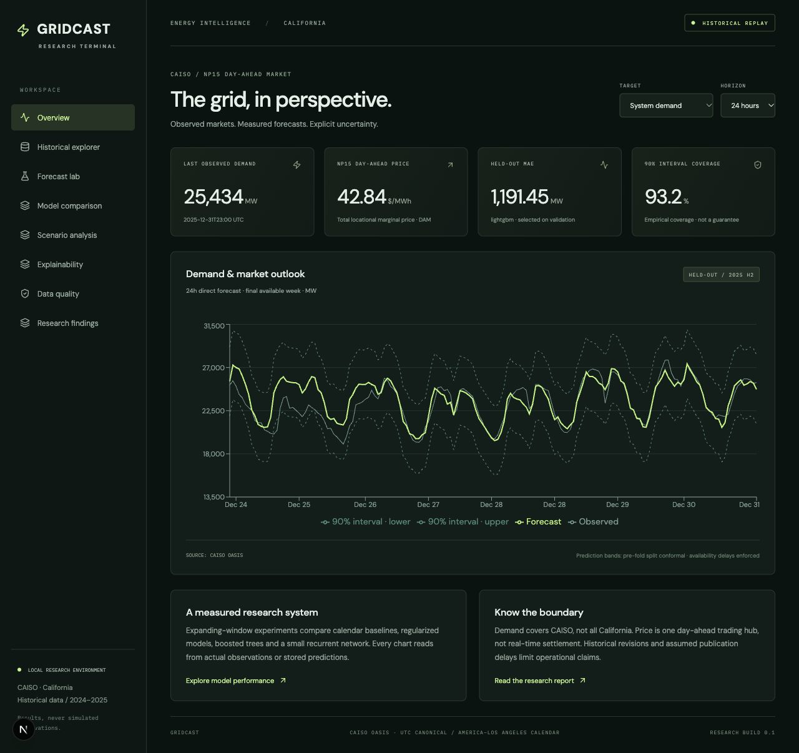
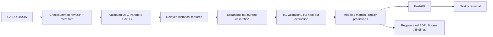

# GridCast
### California electricity demand & day-ahead price forecasting

A standalone, local energy forecasting research platform built on authentic CAISO observations. It executes reproducible acquisition, issue-aware feature engineering, historical validation, model comparisons, calibrated interval evaluation and artifact-backed dashboard inference.

**Research release 0.1.** This is a tested local application, not a production-certified or publicly deployed forecasting service. No portfolio website was modified. [Implementation boundaries](docs/status.md) are explicit.

## Verified results

Two years of observations (2024–2025): **17,543 demand hours**, one preserved gap; **17,544 NP15 DAM price hours**, complete coverage. Prices include **559 negative hourly values**. The executed experiment evaluates **856,240 per-model forecasts** across two validation and two held-out quarters. This count includes correlated candidate predictions, not independent test samples.

| 24-hour target | Validation-selected model | Held-out MAE | Change vs weekly seasonal naive | 90% interval coverage |
|---|---|---:|---:|---:|
| CAISO actual demand | LightGBM | 1,191.45 MW | 31.2% MAE reduction | 93.2% |
| NP15 day-ahead total LMP | Ridge, alpha 100 | $6.03/MWh | 7.1% MAE reduction | 90.7% |

Each row uses 4,368 eligible hourly origins in July–December 2025. Results are historical and conditional on the documented publication-delay assumptions. The selected 48-hour price model is **1.8% worse** than seasonal naive; full tables retain weak results. Metrics are reproducible from `experiments/results/predictions.parquet`. [Generated report](reports/gridcast_report.pdf), [source](reports/gridcast_report.md), [complete metrics](experiments/results/summary.json).

## Terminal



Eight working sections: overview, historical explorer, forecast replay lab, held-out model comparison, model-connected historical feature scenarios, validation permutation importance, source quality and research findings. Every number is loaded from observed data or real experiment output. There are no seeded demo market values. Forecast replay is explicitly historical; data acquisition time is separate from observation freshness.

The interface uses Next.js, TypeScript, React and Recharts with a restrained dark energy-terminal design. FastAPI supplies validated endpoints; browser code never loads model files or credentials. [Two-minute demonstration script and interview materials](docs/portfolio_materials.md).

## Business motivation and boundaries

Compare forecasting methods for demand planning research, peak-error assessment and price-risk monitoring. This project does not optimize trades or procurement policies and does not estimate financial savings. CAISO demand is not all California demand. Price is one NP15 day-ahead hub, not statewide retail or real-time market price.

Short-horizon day-ahead targets may already be published at issue time. Price experiments are **delivery-time-anchored statistical forecasts**, not gate-closure-aware auction submissions. Corrected historical observations are not authentic issue-time vintages. These limitations matter more than a favorable leaderboard.

## Architecture



[Architecture](docs/architecture.md) · [Data source register](docs/data_sources.md) · [Methodology](docs/methodology.md) · [Deployment](docs/deployment.md).

## Data and temporal protocol

- CAISO OASIS `SLD_FCST`, ACTUAL, CA ISO-TAC: hourly integrated actual load (MW).
- CAISO OASIS `PRC_LMP`, DAM, TH_NP15_GEN-APND: hourly total LMP (USD/MWh); price components are filtered, never mixed.
- EIA-930: 48-hour API sample verified, not merged into model inputs.
- Open-Meteo: hourly Sacramento historical reanalysis for retrospective weather plots only; no future realized weather enters predictors.
- NOAA and CEC: researched, integration deferred. Their availability is not falsely treated as an acquired modeling dataset.

UTC interval starts are canonical. Local calendar features use America/Los_Angeles with both fall-back offsets retained. Missing outcomes are never filled. Demand observations are conservatively available at interval start +3 hours, prices at delivery start +48 hours. These assumptions are not verified publication timestamps. Raw responses and manifests preserve download time and source URL.

## Models and experimental design

Direct horizons: **1, 6, 24, 48, 168 hours**. Four baselines: persistence, seasonal naive, historical average, weekday/hour average. Models: ridge (alpha 1/100), regularized direct seasonal AR, XGBoost, LightGBM and small CPU PyTorch GRU. Neural input uses ten irregular lag values plus rolling/calendar context; it is not a TFT or full-history sequence model.

2024 initializes training; Jan–Mar and Apr–Jun 2025 validation select models independently by target/horizon. Jul–Sep and Oct–Dec are held-out evaluation. Quarterly expanding refits have training-only standardization, label publication purges and a separate 720-hour calibration block. Fit uses every third hour to limit CPU cost. No random train/test split. Fixed candidate settings and selected model identity do not use final-test results.

Metrics: MAE, RMSE, sMAPE, MASE, bias, 95th-percentile absolute error; approximate block-bootstrap MAE intervals; season/hour/weekend/high-value/volatility segments. Split-conformal interval radius is calibrated before each quarter and checked for empirical coverage. Serial dependence prevents claiming blanket coverage guarantees. Permutation importance uses validation data only, not a causal attribution.

ARIMA/SARIMAX/ETS, more neural architectures and SHAP are not claimed as executed. Full fit parameters, timestamps, data/config hashes, sample counts, runtime, seed and feature names live in the lightweight registry inside `summary.json`. MLflow is not required for this local immutable-artifact workflow.

## Installation

Python 3.11+ and Node 22+. Tested locally with Python 3.13 and Node 24. From this repository root:

```bash
python3 -m venv .venv
source .venv/bin/activate
python -m pip install -r requirements-lock.txt
python -m pip install -e .
npm ci --prefix dashboard
```

The Python lock reflects the tested macOS/arm64 environment. On Linux or a different Python minor, `pip install -e '.[dev,deep]'` resolves compatible packages instead; then run tests and record that environment. On macOS `scripts/python.sh` can use PyTorch's bundled OpenMP runtime for XGBoost/LightGBM. Standard Homebrew `libomp` is another option. The script does not install or alter system libraries.

## Reproduce all results

```bash
./scripts/python.sh -m gridcast.cli ingest
./scripts/python.sh -m gridcast.cli prepare
./scripts/python.sh pipelines/discover_sources.py
./scripts/python.sh -m gridcast.cli train
./scripts/python.sh -m gridcast.cli report
./scripts/python.sh -m pytest -q
ruff check src api tests
npm run typecheck --prefix dashboard
npm run build --prefix dashboard
```

Acquisition is network-dependent, rate-limited and resumable at successful checksummed chunks. Model inputs require no paid service or API key. Data are not committed to Git. Raw ZIPs preserve exact downloaded payloads; future downloads can include source revisions and therefore yield different hashes/results. Reproduce against preserved raw files for exact-input comparisons. Hardware/library differences can affect neural results and timing.

The provided report is generated using ReportLab from maintainable Python + Markdown, not Quarto. `gridcast report` regenerates figures, metric CSVs, PDF and review-only portfolio materials. No fabricated notebook output is required.

Configuration lives in `configs/default.yaml`. Overrides use `--config path/to/configs/file.yaml`; paths resolve relative to the configuration's project root. Run ingestion, preparation and training sequentially. The reserved `calibration_gap_hours` config field is not used: horizon + delay determine the actual purge; see methodology.

## Run the application

Two terminals, both from this repository root:

```bash
source .venv/bin/activate
./scripts/python.sh -m uvicorn api.main:app --host 127.0.0.1 --port 8000
```

```bash
npm run dev --prefix dashboard
```

Open http://127.0.0.1:3000 . OpenAPI documentation: http://127.0.0.1:8000/docs . Restart the API after replacing an experiment snapshot; its caches assume immutable artifacts. No live inference/update scheduler is running.

## API

| Route | Behavior |
|---|---|
| `GET /health` | Ready/not-ready and historical mode |
| `GET /api/overview` | Latest observed values, source coverage and chosen models |
| `GET /api/history/{demand,price}` | Date-filtered real observations, bounded row count |
| `GET /api/origins` | Eligible held-out issue timestamps |
| `POST /api/forecast` | Historical artifact-backed forecast replay |
| `GET /api/comparisons` | Per-target/horizon validation and test metrics |
| `GET /api/models` | Full lightweight model registry / provenance |
| `POST /api/scenario` | Same fitted model recomputed under historical-level perturbation |
| `GET /api/importance` | Validation permutation importance |
| `GET /api/segments` | Season/hour/day/event performance |
| `GET /api/quality` | Coverage, missingness, outlier flags and dataset hashes |
| `GET /api/replay` | Bounded actual/forecast/interval series |
| `GET /api/report` | Generated research PDF |

Forecast request: `{"target":"demand","horizon":24,"model":"lightgbm","issue_time":"2025-12-15T00:00:00Z"}`. Only eligible held-out origins are accepted. Scenario requests add `historical_level_change_pct` between -20 and 20 and require a fitted model. Calendar remains fixed while lag/rolling levels change. This sensitivity is not a future-temperature intervention and has no calibrated scenario intervals.

## Validation and CI

`pytest tests/test_temporal.py` runs source parsing, product filtering, duplicate checks, negative-price preservation, DST, causal-feature mutation checks, calibration metrics and model serialization tests. These small synthetic unit fixtures test logic; they are never substituted for historical observations. `pytest tests/test_api.py` additionally requires the executed dataset and experiment artifacts and verifies real inference/replay/scenario agreement and endpoint behavior.

GitHub Actions runs lint, temporal/model tests, dashboard type checks and build without downloading large datasets. It is configured but not remotely executed in this session. API integration tests run locally against real generated outputs. See `verification.json` for the exact local checks performed.

## Deliverables and next work

The local directory includes actual raw/processed data, models, results, report, source and dashboard. `.gitignore` excludes large raw/processed/model files from a future Git repository; do not accidentally force-add them. Source datasets retain CAISO / EIA / Open-Meteo terms independently of the MIT code license.

Next priorities: real publication/revision vintages, gate-closure-aware DAM tasks, archived forecast weather, renewable/net-load data and regional prices, holiday effects, untouched prospective holdout, operational monitoring, safe scheduled promotion and public demonstration deployment. No paid cloud service was introduced. [Review-ready portfolio/case-study/resume/interview/demo materials](docs/portfolio_materials.md) are prepared as files only.

## GitHub distribution

The public repository includes source code, configuration examples, acquisition and training pipelines, tests, the dashboard, documentation, screenshots, verified summary metrics and the technical report. Raw/processed datasets, trained model artifacts and the bulky per-origin predictions Parquet are intentionally excluded, along with dependencies, build outputs, real environment files, virtual environments and temporary files. Local copies are preserved. Run the reproduction commands above to regenerate the excluded files before starting the full application or API integration tests.
