# Architecture

```mermaid
flowchart LR
    CAISO[CAISO OASIS ZIP / CSV] --> RAW[Raw responses + SHA256 manifests]
    RAW --> CHECK[Product filters / UTC / hourly validation]
    CHECK --> STORE[Parquet + DuckDB]
    STORE --> FEAT[Issue-safe lags and local calendar features]
    FEAT --> FIT[Quarterly expanding fit / purged calibration]
    FIT --> VAL[2025 H1 validation / fixed selection]
    VAL --> TEST[2025 H2 held-out evaluation]
    TEST --> REG[Artifact registry + predictions + metrics]
    REG --> API[FastAPI]
    API --> UI[Next.js research terminal]
    REG --> REPORT[Regenerated figures / PDF / portfolio materials]
```

All paths resolve from the selected configuration file: the root is its grandparent. Run from repository root or pass `--config /path/to/configs/default.yaml`. API uses `GRIDCAST_CONFIG` when supplied. Inputs stay local; the browser cannot access serialized artifacts. Never load third-party joblib files: pickle-based models are trusted local build artifacts.

## Storage contracts

- Raw OASIS: exact ZIP plus URL, acquisition timestamp, bytes, source row count and SHA-256 JSON manifest.
- Cleaned Parquet: timestamp, interval_end, value, local_time (offset preserved), available_at (assumed), target, unit, market, location.
- DuckDB: physical demand/price tables rebuilt from validated Parquet. Source ZIPs retain the original source columns.
- Features: deterministic in-memory direct-horizon matrices. Feature names and config hash persist in each registry record; no unnecessary duplicated feature warehouse.
- Results: per-fold metrics CSV; per-origin predictions Parquet; summary JSON; segment and permutation-importance CSVs.
- Artifacts: one trusted joblib for every fitted target/horizon/model/test-fold combination. The registry is the lightweight model registration system; no external MLflow server required.
- Reports: reproducible Markdown, PDF, PNG figures, metric tables and review-only portfolio materials.

The API caches immutable experiment snapshots and 20 recently used models. Restart after retraining. This is a single-process local research service, without multi-user auth, online writes, distributed jobs or production SLAs.
